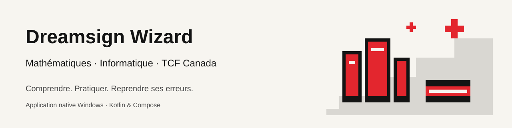
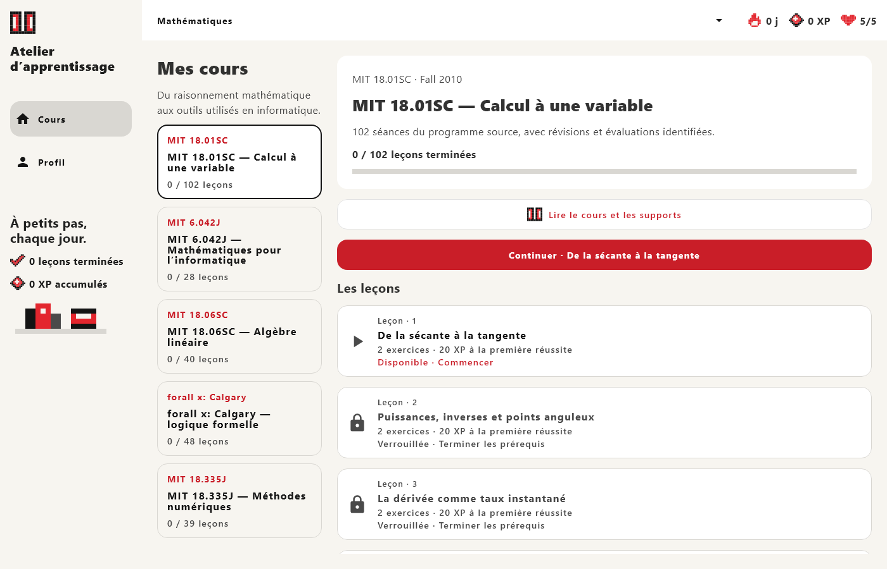
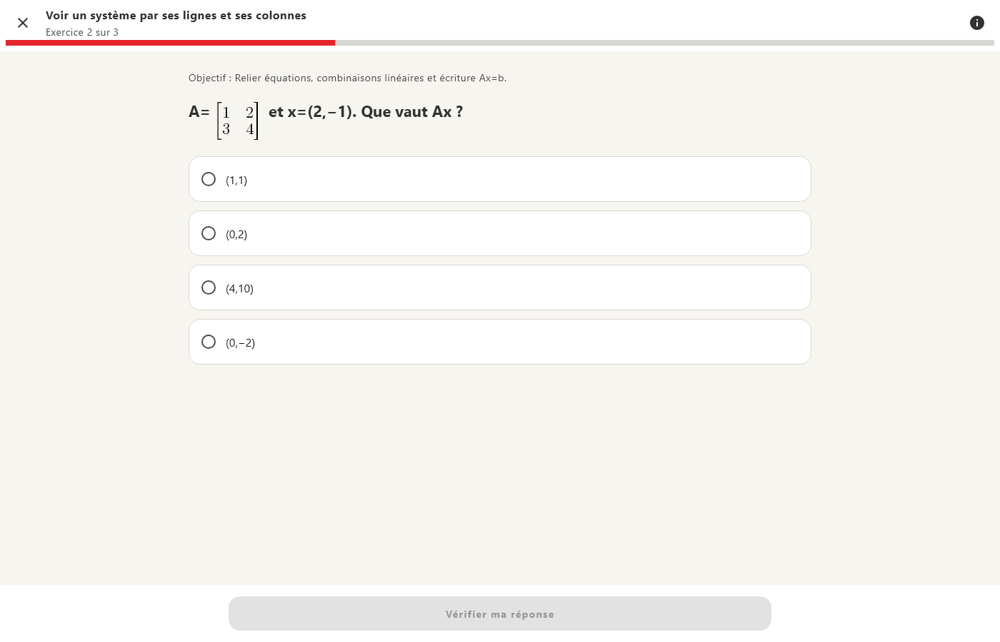

  

# Atelier d’apprentissage

Application d’apprentissage en français pour Windows, développée en Kotlin avec Compose Multiplatform. Elle réunit des cours de mathématiques et d’informatique ainsi que des ateliers de préparation au TCF Canada, avec exercices interactifs et suivi de progression.

[Installation](#installation) · [Développement](#développement) · [Catalogue des cours](docs/courses/README.md) · [Documentation](#documentation)

## Fonctionnalités

- Lecture des notes de cours avec sommaire, ressources de référence et exercices associés.
- Consultation des supports PDF dans l’application, avec défilement vertical continu et zoom.
- Exercices avec indices, corrections expliquées et reprise des questions incorrectes en fin de séance.
- Affichage des expressions mathématiques avec un moteur de rendu LaTeX local.
- Ateliers TCF de compréhension écrite et orale, rédaction et production orale avec réécoute et auto-évaluation.
- Sauvegarde locale de la progression, des XP, du cours sélectionné et des brouillons.
- Interface de bureau avec navigation latérale et disposition adaptée au redimensionnement.

Exemple d’exercice de mathématiques

## Catalogue pédagogique

Le catalogue comprend **15 unités, 391 leçons et ateliers et 1 190 exercices**.

| Catégorie | Domaines |
| --- | --- |
| Mathématiques | Calcul à une variable, mathématiques discrètes, algèbre linéaire, logique formelle et méthodes numériques |
| Informatique | Python, outils du développeur, architecture des ordinateurs, Prolog, théorie du calcul et théorie algorithmique des jeux |
| TCF Canada | Compréhension orale et écrite, expression orale et écrite |

Les cours s’appuient notamment sur OSSU, MIT OpenCourseWare et les références de France Éducation international. Chaque unité identifie son cours source; les notes et exercices sont des adaptations rédigées pour l’application.

La couverture du cursus OSSU et de la préparation TCF est partielle. Les exercices adaptés ne remplacent pas l’ensemble des devoirs, projets et évaluations des cours sources. Les ateliers TCF ne délivrent pas de score officiel ni de correction automatique des productions.

Consulter le [catalogue détaillé](docs/courses/README.md) et la [couverture pédagogique](docs/curriculum/AUTHORED-COVERAGE.md).

## Installation

1. Ouvrir la [dernière release Windows](https://github.com/Dreamsigner/duolingo-kmp-learning-app/releases/latest).
2. Télécharger l’installateur **AtelierApprentissage-1.5.2-Setup.exe**.
3. Lancer **AtelierApprentissage-1.5.2-Setup.exe** et suivre l’assistant. L’installation est propre à l’utilisateur Windows, avec raccourcis sur le Bureau et dans le menu Démarrer.

Java est inclus : aucun JDK ni Gradle n’est nécessaire. La désinstallation se fait depuis les applications installées des paramètres Windows. L’installateur n’est pas signé numériquement; Windows peut afficher un avertissement d’éditeur inconnu. `SHA256SUMS.txt` accompagne l’exécutable pour vérifier l’intégrité du téléchargement.

L’artefact **DuolingoKmpApp-Windows** reste disponible pour une utilisation portable : extraire le ZIP et lancer `DuolingoKmpApp.exe`, avec les dossiers `app` et `runtime` à ses côtés.

Dans le sommaire des cours de mathématiques, une recherche par titre ou objectif permet d’atteindre une leçon, sans modifier son ordre ni ses prérequis.

Dans les supports de mathématiques, les vidéos disposent de cartes avec titre, vignette YouTube lorsqu’elle est disponible et ouverture directe dans le navigateur. Les fichiers MP4 conservent une carte sans vignette. Le bouton **Lire dans l’app** ouvre le lecteur source dans une fenêtre de l’application : YouTube conserve ses commandes officielles, les MP4 utilisent celles du moteur vidéo Edge WebView2. Vitesse, sous-titres et qualité dépendent de la source. Le runtime Microsoft Edge WebView2 doit être présent; le bouton navigateur reste disponible.

Les notes et documents audio sont intégrés; les supports PDF externes et les vidéos nécessitent une connexion Internet.

La version installée à l’emplacement Windows standard vérifie automatiquement les releases GitHub stables. Les mises à jour sont téléchargées et vérifiées, puis appliquées à la fermeture de l’application. Le réglage **Mises à jour auto** permet de désactiver ce comportement; **Installer et redémarrer** applique immédiatement une version déjà prête. Les versions portables et installations dans un autre dossier conservent une mise à jour manuelle.

La progression est enregistrée dans `%LOCALAPPDATA%/AtelierApprentissage/progress.json`. Elle n’est pas synchronisée entre appareils.

Voir le [guide Windows](docs/windows-testing.md) pour le diagnostic et la gestion des données locales.

## Développement

### Prérequis

- Windows et JDK 17.
- Gradle 8.11.1, disponible dans le `PATH`. Le dépôt ne contient pas de wrapper Gradle.
- Python 3.12 pour les outils de contenu pédagogique; SymPy 1.12 pour les contrôleurs mathématiques.

Versions du projet : Kotlin **2.2.21** et Compose Multiplatform **1.9.3**. Les dépendances sont déclarées dans `gradle/libs.versions.toml` et `composeApp/build.gradle.kts`.

### Commandes

À exécuter depuis la racine du dépôt :

| Commande | Usage |
| --- | --- |
| `gradle :composeApp:compileKotlinDesktop` | Compiler l’application Windows |
| `gradle :composeApp:desktopTest` | Exécuter les tests Kotlin et Compose desktop |
| `gradle :composeApp:createDistributable` | Construire l’application portable avec son runtime |
| `gradle :composeApp:packageExe` | Construire l’installateur Windows par utilisateur |
| `gradle :composeApp:sourcePdfSmokeTest` | Vérifier le lecteur avec un PDF officiel; nécessite Internet |
| `python tools/validate_curriculum.py --generate` | Valider le catalogue et régénérer les données Kotlin |
| `python tools/validate_course_resources.py` | Vérifier l’index des supports pédagogiques |
| `python tools/export_course_notes.py --check` | Vérifier les exports Markdown des cours |

Après construction, le lanceur se trouve dans `composeApp/build/compose/binaries/main/app/DuolingoKmpApp/`.

### Structure du projet

| Dossier | Rôle |
| --- | --- |
| `composeApp/src/commonMain/` | Interface Compose, modèles et logique d’apprentissage partagés |
| `composeApp/src/desktopMain/` | Lanceur Windows, stockage local, audio et lecteurs de documents |
| `composeApp/src/commonTest/`, `composeApp/src/desktopTest/` | Tests de logique, de persistance et d’interface |
| `curriculum/courses/` | Contenus pédagogiques canoniques au format JSON |
| `tools/` | Validation, contrôles pédagogiques et génération des contenus |
| `docs/courses/` | Notes de cours et exercices consultables sur GitHub |
| `.github/workflows/` | Vérifications et création du paquet Windows |

Windows est la plateforme actuellement distribuée. Les cibles Android et iOS restent présentes dans le code Kotlin Multiplatform, sans distribution maintenue.

### Contributions

Pour modifier le contenu pédagogique, travailler dans `curriculum/courses/`, conserver les identifiants publiés et préciser les sources. Régénérer les fichiers dérivés avec les outils du dépôt plutôt que de modifier directement le catalogue Kotlin généré.

Pour une modification applicative, ajouter ou adapter les tests concernés et décrire son comportement dans la pull request. Le workflow `Build` vérifie les contenus, exécute les tests desktop et construit le paquet Windows.

## Documentation

- [Utilisation et diagnostic Windows](docs/windows-testing.md)
- [Tests automatisés](docs/automated-testing.md)
- [Bibliothèque des cours](docs/courses/README.md)
- [Couverture pédagogique](docs/curriculum/AUTHORED-COVERAGE.md)
- [Sources et supports](docs/curriculum/course-resources-notes.md)
- [Rendu mathématique](docs/math-typesetting.md)

## Références et licences tierces

[OSSU Computer Science](https://github.com/ossu/computer-science) · [MIT OpenCourseWare](https://ocw.mit.edu/) · [France Éducation international — TCF Canada](https://www.france-education-international.fr/test/tcf-canada)

Les supports externes restent soumis aux licences de leurs éditeurs. Les licences et attributions des bibliothèques distribuées sont regroupées dans [`docs/licences/`](docs/licences/).
